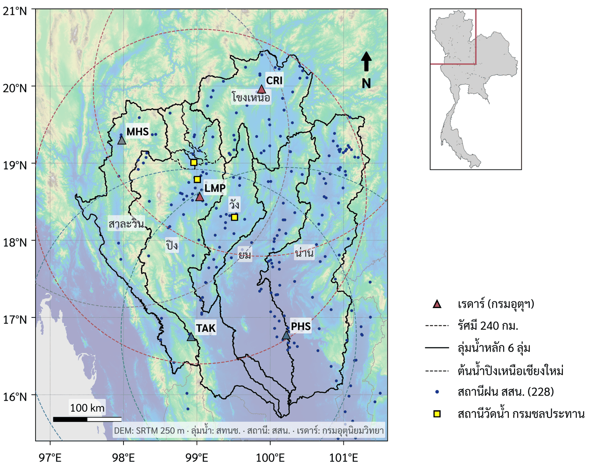
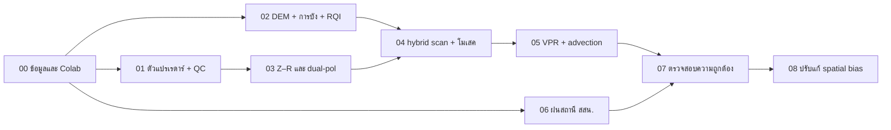
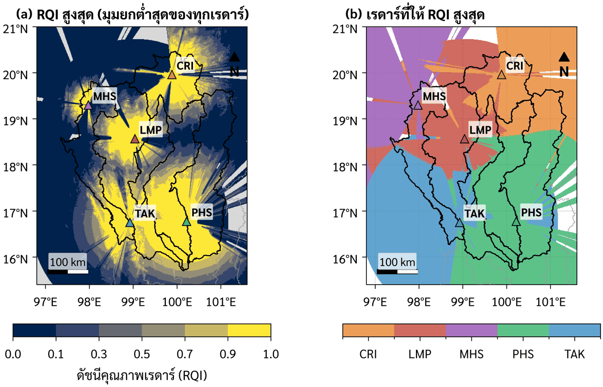
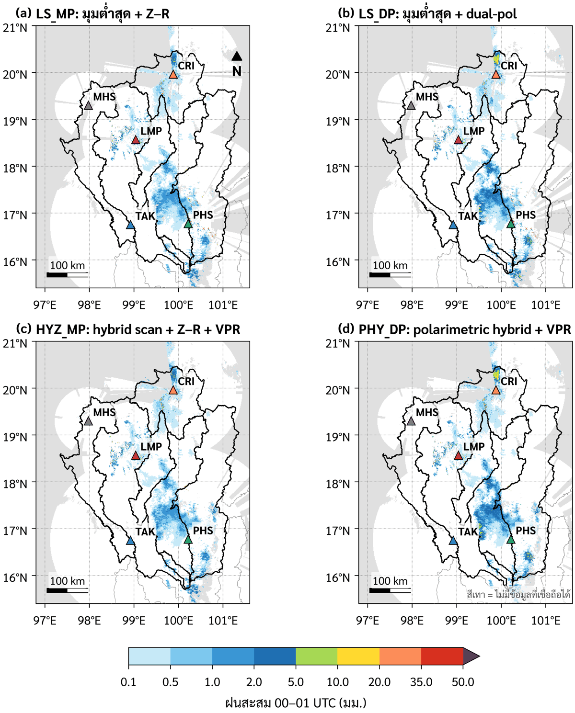
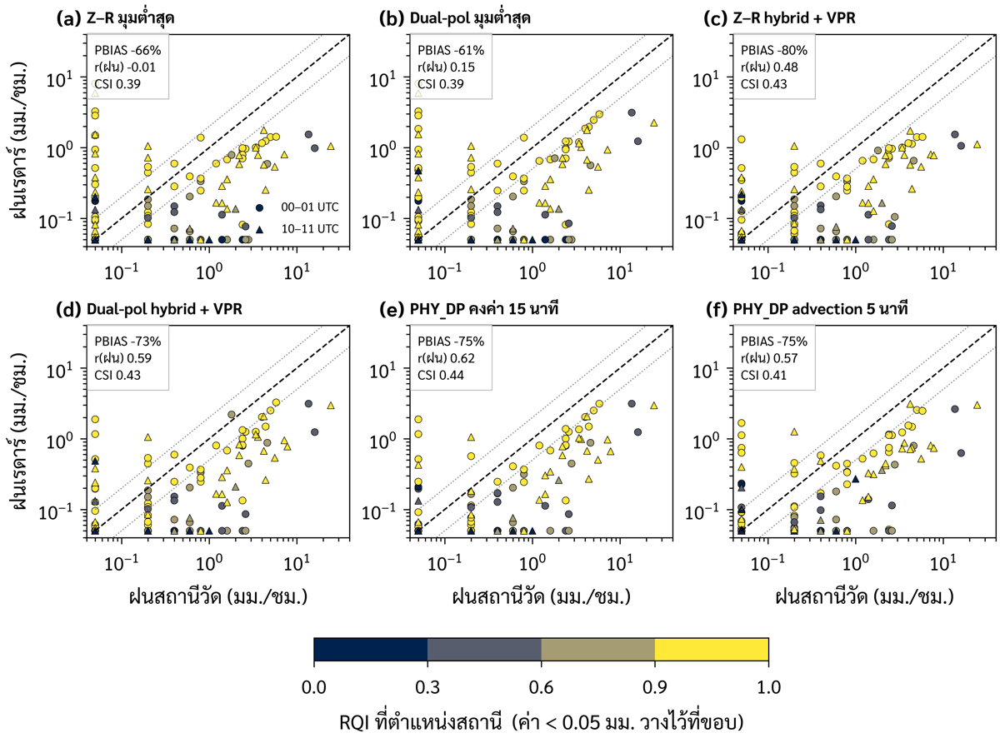
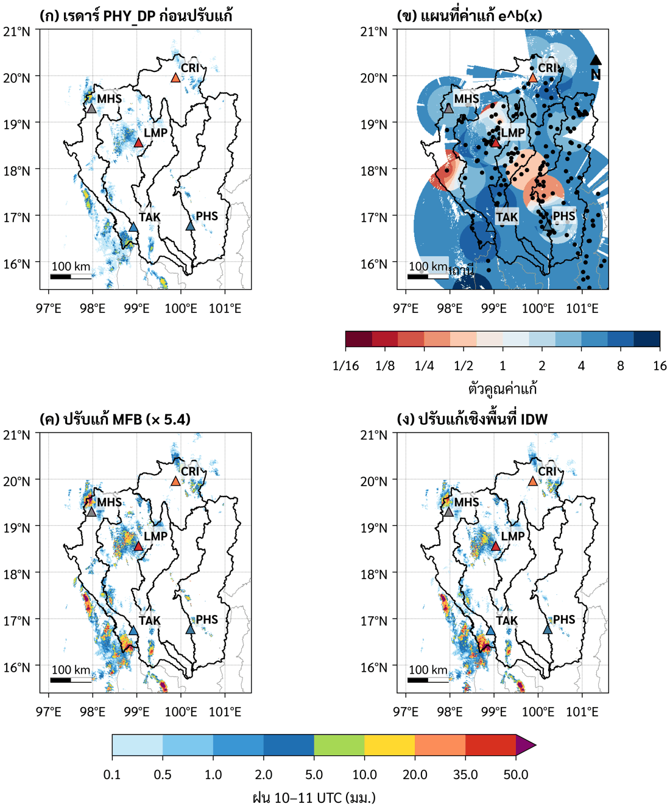

# เรดาร์ตรวจอากาศเพื่อการประมาณฝน: RQI Mosaic · Dual-Polarization · Spatial Bias
### Weather-radar rainfall for environmental scientists — a hands-on course with the Chiang Mai flood of October 2024

[](https://colab.research.google.com/github/nattaponm/Teach_RQI_Mosaic_SpatialBias_DualPol/blob/main/notebooks/00_setup_and_data.ipynb)
[](LICENSE)
[](LICENSE-CONTENT.md)
[](requirements.txt)
[](https://github.com/nattaponm/Teach_RQI_Mosaic_SpatialBias_DualPol/actions/workflows/smoke-test.yml)

<p align="center"></p>

ชุดบทเรียน Jupyter/Colab 9 บท สำหรับ **นิสิตปริญญาตรีปี 3–4 และปริญญาโท สาขาวิทยาศาสตร์สิ่งแวดล้อม/ภูมิศาสตร์/ทรัพยากรน้ำ**
เรียนตั้งแต่การอ่านข้อมูลเรดาร์ดิบ การควบคุมคุณภาพ การคำนวณการบังลำคลื่นจาก DEM การสร้างดัชนีคุณภาพเรดาร์ (RQI)
การประมาณฝนด้วย Z–R และ dual-polarization การโมเสคเรดาร์หลายสถานี การแก้ VPR การดึงฝนสถานี สสน.
การตรวจสอบความถูกต้อง ไปจนถึงการปรับแก้ความเอนเอียงเชิงพื้นที่ ทั้งหมดใช้ **ข้อมูลจริงของเหตุการณ์น้ำท่วมเชียงใหม่ 3 ตุลาคม 2567**
และรันได้บน Google Colab โดยไม่ต้องติดตั้งอะไรบนเครื่อง

> **English summary.** Nine Colab-ready notebooks that take environmental-science students from raw TMD C-band dual-pol
> radar volumes (UF) to a gauge-adjusted, RQI-weighted multi-radar rainfall mosaic for northern Thailand. Topics: radar
> variables and QC, ZDR/ΦDP calibration, KDP and attenuation correction, DEM mosaicking and beam blockage, the MRMS-style
> radar quality index, Z–R vs. polarimetric estimators, (polarimetric) hybrid scans, melting-layer detection and VPR
> correction, advection-corrected accumulation, HII open-data rain gauges, verification metrics, and spatial bias
> adjustment with cross-validation. Each notebook has objectives, theory with equations, worked code, interpretation,
> exercises with hidden solutions and research questions. Text is in Thai with English technical terms.

---

## 🎯 ผลลัพธ์การเรียนรู้ของรายวิชา
เมื่อเรียนครบ นิสิตจะสามารถ
1. อธิบายหลักการวัดฝนด้วยเรดาร์ dual-polarization และข้อจำกัดในพื้นที่ภูเขา
2. ประมวลผลข้อมูลเรดาร์ดิบด้วย Python (Py-ART) ตั้งแต่ QC จนเป็นแผนที่ฝนรายชั่วโมง
3. ใช้ DEM และระบบสารสนเทศภูมิศาสตร์ประเมินคุณภาพการสังเกตของเครือข่ายเรดาร์ (RQI)
4. เปรียบเทียบและเลือกวิธีประมาณฝนที่เหมาะสมด้วยหลักฐานเชิงปริมาณจากฝนสถานี
5. ปรับแก้ฝนเรดาร์ด้วยฝนสถานีและประเมินอย่างยุติธรรมด้วย cross-validation
6. สร้างแผนที่และกราฟตามมาตรฐานวารสารวิชาการ และทำงานแบบทำซ้ำได้ (reproducible) ด้วย GitHub

**พื้นฐานที่ควรมี:** Python เบื้องต้น (numpy, pandas, matplotlib), สถิติเบื้องต้น, GIS เบื้องต้น (ระบบพิกัด, raster/vector)

---

## 📚 บทเรียน

| # | บทเรียน | เรียนอะไร | ระดับ | เวลา | เปิดใน Colab |
|:-:|---|---|:-:|:-:|:-:|
| 00 | **เตรียมสภาพแวดล้อมและข้อมูล** | โครงสร้าง repo, ดาวน์โหลด + checksum, โครงสร้าง volume/sweep/ray/gate, inventory, แผนที่พื้นที่ศึกษา, ตั้งค่า fork + token | 🟢 | 45 น. | [](https://colab.research.google.com/github/nattaponm/Teach_RQI_Mosaic_SpatialBias_DualPol/blob/main/notebooks/00_setup_and_data.ipynb) |
| 01 | **ข้อมูลเรดาร์ dual-pol และการควบคุมคุณภาพ** | Z, ZDR, ρhv, ΦDP, KDP, V, W · แยกฝนจาก clutter · ปรับเทียบ ZDR และ system phase · KDP · ZPHI | 🟢🔵 | 2 ชม. | [](https://colab.research.google.com/github/nattaponm/Teach_RQI_Mosaic_SpatialBias_DualPol/blob/main/notebooks/01_radar_basics_qc.ipynb) |
| 02 | **DEM, การบังลำคลื่น และ RQI** | โมเสค DEM · ความสูงลำคลื่น (4/3 earth) · PBB/CBB · RQI แบบ MRMS · เรดาร์ที่ดีที่สุดรายพิกเซล · zonal statistics | 🟢🔵 | 2 ชม. | [](https://colab.research.google.com/github/nattaponm/Teach_RQI_Mosaic_SpatialBias_DualPol/blob/main/notebooks/02_dem_beam_blockage_rqi.ipynb) |
| 03 | **Z–R และการประมาณฝนแบบ dual-pol** | DSD → Z–R · Marshall–Palmer/Rosenfeld · R(KDP), R(A) · blended · ความไวต่อการปรับเทียบ | 🟢🔵 | 2 ชม. | [](https://colab.research.google.com/github/nattaponm/Teach_RQI_Mosaic_SpatialBias_DualPol/blob/main/notebooks/03_zr_and_dualpol_qpe.ipynb) |
| 04 | **Hybrid scan และโมเสคเรดาร์ด้วย RQI** | Hybrid scan (NEXRAD) · polarimetric hybrid scan · โมเสคถ่วงน้ำหนัก/ค่าสูงสุด · 15 นาที → ชั่วโมง · GeoTIFF | 🟢🔵 | 2 ชม. | [](https://colab.research.google.com/github/nattaponm/Teach_RQI_Mosaic_SpatialBias_DualPol/blob/main/notebooks/04_hybrid_scan_rqi_mosaic.ipynb) |
| 05 | **ชั้นหลอมเหลว, VPR และการสะสมฝนตามเวลา** | ML จาก ρhv · apparent VPR · การแก้ VPR · advection (optical flow) Δt = 1/5/10/15 นาที | 🟢🔵 | 1.5 ชม. | [](https://colab.research.google.com/github/nattaponm/Teach_RQI_Mosaic_SpatialBias_DualPol/blob/main/notebooks/05_vpr_melting_layer_accumulation.ipynb) |
| 06 | **ฝนสถานีโทรมาตร สสน.** | Open data API · `quality_flag` · ตรวจค่าค้าง/เพื่อนบ้าน · เวลาไทย → UTC (ปลายชั่วโมง) · ความพร้อมของข้อมูล | 🟢🔵 | 1.5 ชม. | [](https://colab.research.google.com/github/nattaponm/Teach_RQI_Mosaic_SpatialBias_DualPol/blob/main/notebooks/06_rain_gauges_hii.ipynb) |
| 07 | **ตรวจสอบความถูกต้องและแปลผล** | จับคู่จุด-พิกเซล · PBIAS, RMSE, r, NSE, KGE, POD, FAR, CSI, HSS · แยกตามลุ่มน้ำ/RQI · bootstrap | 🟢🔵 | 2 ชม. | [](https://colab.research.google.com/github/nattaponm/Teach_RQI_Mosaic_SpatialBias_DualPol/blob/main/notebooks/07_verification_interpretation.ipynb) |
| 08 | **ปรับแก้ความเอนเอียงเชิงพื้นที่ (spatial bias)** | Mean-field bias · log-ratio · IDW · LOOCV · Moran's I · 🔵 variogram/kriging · ถ่ายโอนค่าแก้ข้ามลุ่มน้ำ | 🟢🔵 | 2 ชม. | [](https://colab.research.google.com/github/nattaponm/Teach_RQI_Mosaic_SpatialBias_DualPol/blob/main/notebooks/08_spatial_bias_correction.ipynb) |

🟢 = แกนหลักสำหรับ ป.ตรี ปี 3–4 · 🔵 = ส่วนขยายสำหรับ ป.โท (แบบฝึกหัดและหัวข้อที่ทำเครื่องหมาย 🔵)

**ทุก notebook มีโครงสร้างเดียวกัน:** วัตถุประสงค์ → หลักการและสมการ → ปฏิบัติการทีละขั้น → แปลผลด้วยข้อมูลจริง →
แบบฝึกหัด (🟢/🔵) พร้อม **เฉลยที่ซ่อนไว้** (ดับเบิลคลิกเพื่อเปิด) → คำถามชวนคิด/ต่อยอดงานวิจัย → เอกสารอ้างอิง → บันทึกผลขึ้น GitHub

### ลำดับการเรียน

ทุกบทเริ่มเรียนแยกกันได้ เพราะ notebook 00 ดาวน์โหลด **ผลลัพธ์สำเร็จรูป** ของบทก่อนหน้าไว้ให้แล้ว

---

## 🌧️ กรณีศึกษา: น้ำท่วมเชียงใหม่ ตุลาคม 2567
ร่องความกดอากาศต่ำทำให้ฝนตกหนักต่อเนื่องบนต้นน้ำปิง (แม่แตง เชียงดาว แม่งัด) ระดับน้ำที่ P.1 สะพานนวรัฐสูงเป็นประวัติการณ์ราว 5.3 ม.
ในคืน 4–5 ต.ค. 2567 รายวิชาใช้ข้อมูลวันที่ 3 ต.ค. 2567 สองช่วง: **00–01 UTC** (ฝน stratiform) และ **10–11 UTC** (ฝนพาความร้อน)

| ข้อมูล | รายละเอียด |
|---|---|
| เรดาร์ (กรมอุตุนิยมวิทยา) | ย่าน C, dual-pol 5 สถานี: เชียงราย (CRI), ลำพูน (LMP), แม่ฮ่องสอน (MHS), พิษณุโลก (PHS), ตาก/ดอยมูเซอ (TAK) · สแกนทุก 15 นาที · 50 ไฟล์ UF |
| DEM | SRTM v4.1 ลดความละเอียดเป็น 250 ม. 4 แผ่น |
| ฝนสถานี | สสน. รายชั่วโมง 221 สถานีในรัศมีเรดาร์ (ดึงจาก open data ได้โดยตรงใน notebook 06) |
| ขอบเขต | ลุ่มน้ำหลัก/ลุ่มน้ำย่อย สทนช. · สถานีวัดน้ำ P.1, P.67, W.1C (กรมชลประทาน) |

<table>
<tr>
<td><br><sub>02 · RQI และเรดาร์ที่ดีที่สุดรายพิกเซล</sub></td>
<td><br><sub>04 · โมเสคฝนรายชั่วโมง 4 วิธี</sub></td>
</tr>
<tr>
<td><br><sub>07 · เทียบฝนเรดาร์กับฝนสถานี</sub></td>
<td><br><sub>08 · การปรับแก้ความเอนเอียงเชิงพื้นที่</sub></td>
</tr>
</table>

---

## 🚀 เริ่มต้นใช้งาน

### ก. เปิดใน Google Colab (แนะนำ)
1. กดปุ่ม **Open in Colab** ของบทที่ต้องการในตารางด้านบน
2. รันเซลล์ **⚙️ เตรียมสภาพแวดล้อม** (เซลล์แรก) — จะ clone repo, ติดตั้ง Py-ART และดาวน์โหลดข้อมูล (~180 MB ครั้งแรก 1–3 นาที)
3. เลือก *Runtime ▸ Run all* หรือรันทีละเซลล์พร้อมอ่านคำอธิบาย

### ข. บันทึกผลลัพธ์ขึ้น GitHub ของตนเอง (นิสิต)
repository นี้ **อ่านได้อย่างเดียว** สำหรับนิสิต ผลงานของนิสิตเก็บใน **fork ของตนเอง** เท่านั้น
1. กด **Fork** ที่มุมขวาบนของหน้านี้
2. สร้าง *fine-grained personal access token* ที่เข้าถึง **เฉพาะ fork ของตนเอง** สิทธิ์ *Contents: Read and write*
3. ใน Colab เปิดแถบ 🔑 **Secrets** เพิ่ม `GITHUB_USER` และ `GITHUB_TOKEN` (เปิด *Notebook access*)
4. ท้ายทุก notebook มีเซลล์ 💾 — ใส่รหัสนิสิตแล้วรัน ไฟล์ใน `outputs/` จะถูก push ไปที่ branch `results/<รหัสนิสิต>` ของ fork
5. ตัว notebook ที่แก้ไขแล้ว: *File ▸ Save a copy in GitHub* → เลือก fork ของตนเอง

รายละเอียดพร้อมภาพหน้าจอ: [docs/student_guide_fork.md](docs/student_guide_fork.md)
> 🔒 ฟังก์ชันบันทึกผลจะไม่แสดง token ในข้อความผิดพลาด และปฏิเสธการ push เข้าบัญชีของอาจารย์ — นิสิตส่งงานด้วยลิงก์ branch ใน fork ของตนเอง

### ค. รันบนเครื่องตัวเอง
```bash
git clone https://github.com/nattaponm/Teach_RQI_Mosaic_SpatialBias_DualPol.git
cd Teach_RQI_Mosaic_SpatialBias_DualPol
conda env create -f environment.yml && conda activate radteach
jupyter lab notebooks/
```

---

## 🗂️ โครงสร้าง repository
```
├── notebooks/            บทเรียน 00–08 (ไม่มีผลลัพธ์ค้างไว้ เพื่อไม่ให้เห็นคำตอบก่อนทำ)
├── src/radteach/         โค้ดคำนวณที่ใช้ร่วมกัน (io, qc, geometry, dem, qpe, rqi, mosaic, vpr, accum, gauges, verify, bias, mapping, plotting, colab)
├── config/               พารามิเตอร์ทั้งหมด (.yaml) — เปลี่ยนค่าเพื่อทดลองได้โดยไม่ต้องแก้โค้ด
├── data/
│   ├── static/           ขอบลุ่มน้ำ (GeoPackage), metadata สถานี, ฝนสถานี snapshot, ตำแหน่งเรดาร์
│   └── raw/ interim/ processed/   ข้อมูลที่ดาวน์โหลด/คำนวณ (ไม่อยู่ใน git)
├── mapping/              มาตรฐานภาพ: ฟอนต์ Sarabun (OFL), colormap, แม่แบบหน้ากระดาษ
├── outputs/              ผลของนิสิตแต่ละคน (figures/ tables/ rasters/) — ไม่อยู่ใน git ของอาจารย์
├── docs/                 สมการ, อภิธานศัพท์, คู่มือผู้สอน, คู่มือ fork, ภาพประกอบ
├── scripts/              สำหรับผู้สอน: สร้าง notebook จากต้นฉบับ, สร้างชุดข้อมูล release, ตัดเฉลย
├── tests/                ทดสอบฟังก์ชันหลัก
└── .github/              CI ทดสอบ notebook, ปิด PR จาก fork อัตโนมัติ, แม่แบบ issue
```

## 📐 มาตรฐานแผนที่และกราฟ
ทุกภาพสร้างผ่าน `radteach.plotting` และ `radteach.mapping` ให้หน้าตาเดียวกัน:
ความกว้าง 90/140/190 มม. ตามวารสาร · PNG 600 dpi + PDF ฝังฟอนต์ · ฟอนต์ไทย Sarabun · ทุกแกนมีปริมาณและหน่วย ·
แผนที่มีกริดพิกัด มาตราส่วน ทิศเหนือ แผนที่บอกตำแหน่ง และแหล่งข้อมูล · สีฝนแบบระดับไม่ต่อเนื่อง · สีที่คนตาบอดสีอ่านได้ ·
ป้ายแผง (a), (b), … · สลับป้ายไทย/อังกฤษได้ที่ `config/plotting.yaml`

## 📦 ข้อมูลและสิทธิ์การใช้
| แหล่ง | การใช้ในรายวิชา | เงื่อนไข |
|---|---|---|
| ข้อมูลเรดาร์ กรมอุตุนิยมวิทยา | ไฟล์ UF 2 ชั่วโมง (GitHub Release `data-v1.0`) | ใช้เพื่อการศึกษา อ้างอิงกรมอุตุนิยมวิทยา |
| ฝนสถานี สสน. (HII) | open data catalogue | อ้างอิง สสน. |
| ลุ่มน้ำ สทนช. | GeoPackage (simplify แล้ว) | อ้างอิง สทนช. |
| SRTM v4.1 (CGIAR-CSI) | DEM 250 ม. | อ้างอิง Jarvis et al. (2008) |
| ฟอนต์ Sarabun | `mapping/fonts` | SIL Open Font License 1.1 |

รายละเอียด: [DATA_LICENSE.md](DATA_LICENSE.md) · โค้ด: [MIT](LICENSE) · เนื้อหา notebook/เอกสาร: [CC BY 4.0](LICENSE-CONTENT.md)

## 👩‍🏫 สำหรับผู้สอน
- [docs/teacher_guide.md](docs/teacher_guide.md) — แผนการสอนรายสัปดาห์ เวลา เกณฑ์ให้คะแนน การใช้กับ ป.ตรี/ป.โท
- notebook เขียนจากต้นฉบับ `scripts/nbsrc/nbXX.py` → `python scripts/nbsrc/nbXX.py` (แก้ที่ต้นฉบับ แล้วสร้างใหม่)
- `python scripts/strip_solutions.py` สร้างฉบับไม่มีเฉลยสำหรับใช้สอบ
- `python scripts/build_teaching_packages.py` สร้างชุดข้อมูล release ใหม่ (เช่น เพิ่มวันของเหตุการณ์)

## 📖 การอ้างอิง
ถ้านำรายวิชานี้ไปใช้ โปรดอ้างอิงตาม [CITATION.cff](CITATION.cff)

## 🙏 กิตติกรรมประกาศ
ขอบคุณ **กรมอุตุนิยมวิทยา** (ข้อมูลเรดาร์), **สถาบันสารสนเทศทรัพยากรน้ำ (สสน.)** (ฝนสถานีโทรมาตร),
**สำนักงานทรัพยากรน้ำแห่งชาติ (สทนช.)** (ขอบเขตลุ่มน้ำ), **กรมชลประทาน** (สถานีวัดน้ำ) และชุมชนซอฟต์แวร์เปิด
[Py-ART](https://arm-doe.github.io/pyart/), [wradlib](https://docs.wradlib.org/), [pysteps](https://pysteps.github.io/)

## 📚 เอกสารอ้างอิงหลัก
- Fulton, R.A. et al. (1998). The WSR-88D rainfall algorithm. *Weather and Forecasting* 13:377–395.
- Zhang, J. et al. (2016). Multi-Radar Multi-Sensor (MRMS) quantitative precipitation estimation. *BAMS* 97:621–638.
- Ryzhkov, A.V. & Zrnić, D.S. (2019). *Radar Polarimetry for Weather Observations*. Springer.
- Germann, U. et al. (2022). Weather radar in complex orography. *Remote Sensing* 14:503.
- Bech, J. et al. (2003). Beam blockage correction. *J. Atmos. Oceanic Technol.* 20:845–855.
- Goudenhoofdt, E. & Delobbe, L. (2009). Evaluation of radar–gauge merging methods. *HESS* 13:195–203.

## 💬 ติดต่อ
มีคำถามหรือพบข้อผิดพลาด เปิด [Issue](https://github.com/nattaponm/Teach_RQI_Mosaic_SpatialBias_DualPol/issues) ได้เลย
(ผลงาน/การบ้านของนิสิต ส่งผ่านลิงก์ fork ตามที่ผู้สอนกำหนด ไม่ต้องเปิด Pull Request)
